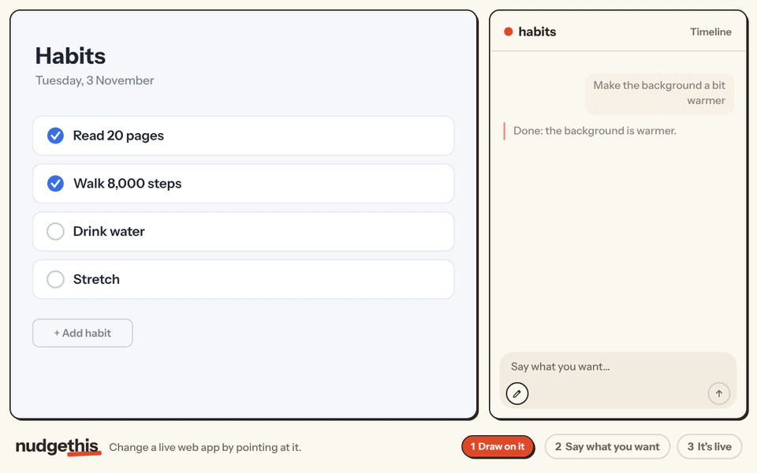

# nudgethis

Change a live web app by pointing at it.



nudgethis shows your app full-size, with a chat beside it. Draw on the app, say what you want, and an agent changes the code. The app reloads in place when the change is live. It works on a phone: hold the pill to draw, tap it to talk.

- **Nudge** is the agent you talk to (an OpenAI model). It turns what you say and draw into a brief.
- **The coder** is a [Cursor Cloud Agent](https://cursor.com). It works on the app's repo and pushes to `main`.
- **[Yard](https://github.com/stariodev/yard)** deploys each push. nudgethis waits for that deploy, then reloads the app.

The home page makes new apps too. Type what you want ("a habit tracker with a streak for each habit"). nudgethis makes a private repo from [nudge-template](https://github.com/stariodev/nudge-template), or from a public GitHub repo that you link. It starts the app on Yard at `https://<name>.<your domain>` and sends your description as the first change.

There is no review step. Every change goes to `main` and to production. "Undo" asks the coder to push a revert. Only the Google accounts that you list can sign in.

## Set it up on Yard

nudgethis runs on a [Yard](https://github.com/stariodev/yard) host and makes its apps there. Yard is a small self-hosted deploy tool. It runs on one Ubuntu VM, builds each `git push` into a container, and serves it over HTTPS through Caddy. Yard builds nudgethis without a Containerfile, because nudgethis is a [Stario](https://stario.dev) app. If you have no Yard host yet, start with [Set up a host](https://stario.dev/yard/install). It takes one script on a fresh VM.

The examples use `nudge.example.com`. Use your own host.

### What you need

1. **A Yard host with GitHub connected.** [Set up a host](https://stario.dev/yard/install), then run `yard forge setup github`. Install Yard's GitHub app on the account that will own the new apps, for **All repositories**. Yard cannot see a repo that it makes under "Only select repositories". A separate GitHub organization for these apps keeps your other repos out of reach.
2. **DNS.** Point two records at the Yard host: `nudge.example.com` and `*.nudge.example.com`. New apps live under the wildcard.
3. **A Google OAuth client.** In the Google Cloud console, go to APIs & Services, then Credentials. Create an OAuth client ID of type "Web application". Add the redirect URI `https://nudge.example.com/auth/google/callback`. If the consent screen is in testing, add your accounts as test users.
4. **A Cursor API key**, from the [Cursor dashboard](https://cursor.com/dashboard). Cursor's GitHub app must reach **all** repositories of the same account, so that it can work on a repo that was made a minute ago.
5. **An OpenAI API key.**

### Deploy

Make a Yard token for nudgethis:

```bash
yard token new nudgethis
```

Then start nudgethis with one command. Put your values in place of the `…`:

```bash
yard app new --app nudgethis --repo https://github.com/stariodev/nudgethis --ref main \
  --caddy nudge.example.com \
  -e NUDGE_PUBLIC_URL=https://nudge.example.com \
  -e NUDGE_ALLOWED_EMAILS=you@example.com \
  -e GOOGLE_CLIENT_ID=… \
  -e GOOGLE_CLIENT_SECRET=… \
  -e YARD_TOKEN=… \
  -e OPENAI_API_KEY=… \
  -e CURSOR_API_KEY=…
```

Yard builds the app, deploys it, and writes the Caddy site for `nudge.example.com`. Open `https://nudge.example.com`, sign in, and type what you want to make.

You can leave out `YARD_TOKEN`, `OPENAI_API_KEY`, and `CURSOR_API_KEY`, and paste them on the Settings page later. Without them, nudgethis runs a scripted model and a fake coder, and it cannot make apps.

From a clone of this repo, `yard app new --app nudgethis --caddy nudge.example.com --edit-env` opens `.env.example` in your editor instead of the `-e` flags.

### Updates

Yard follows `main` of the repo that you gave it. The command above deploys each release of `stariodev/nudgethis` to your host. To choose when you update, deploy your own fork instead. Or add `--trigger manual` and run `yard app deploy --app nudgethis` when you want the new version.

### If something does not work

- **"name the owner account"**: Yard's GitHub app is on more than one account. Set `NUDGE_OWNER` to the account for new apps.
- **"covers selected repos only"**: install Yard's GitHub app for all repositories.
- **A change fails to start**: check that Cursor's GitHub app reaches the new repo.
- **The first deploy of a new app fails**: run `yard app logs --deploy --app nudge-<name>`.
- **Sign-in fails with a redirect error**: the redirect URI in Google must equal `<NUDGE_PUBLIC_URL>/auth/google/callback`.

## Settings

Set these with `yard env set --app nudgethis KEY=VALUE`. The Settings page in nudgethis can change the keys, models, and Yard values without a restart. A value that you save there wins over the environment. Saved secrets are sealed with `SESSION_SECRET`.

Required:

| Key | What it is |
| --- | --- |
| `NUDGE_PUBLIC_URL` | The address of nudgethis, such as `https://nudge.example.com`. Default `http://127.0.0.1:8000`. An `https` address makes the cookie secure. |
| `GOOGLE_CLIENT_ID`, `GOOGLE_CLIENT_SECRET` | The Google OAuth client. Its redirect URI is `<NUDGE_PUBLIC_URL>/auth/google/callback`. |
| `NUDGE_ALLOWED_EMAILS` | The Google accounts that may sign in, comma separated. |

Optional:

| Key | What it is |
| --- | --- |
| `YARD_TOKEN` | A token from `yard token new`. Without it, nudgethis cannot make apps, and a change counts as live when the coder finishes. |
| `YARD_URL` | How nudgethis reaches Yard. Default `http://yard-app-1:8000`, Yard's container on the `yard` network: an app on the Yard host cannot reach the host's public address. On a laptop, use Yard's public address. |
| `OPENAI_API_KEY` | Nudge's model key. Empty means a scripted fake. |
| `OPENAI_BASE_URL` | An OpenAI-compatible endpoint. |
| `NUDGE_MODEL` | Default `gpt-6.1-terra`. |
| `NUDGE_EFFORT` | `none`, `low`, `medium`, or `high`. Default `low`. |
| `CURSOR_API_KEY` | The Cursor key for Cloud Agents. Empty means a fake coder. |
| `CURSOR_MODEL` | The coder's default model, with optional params: `grok-4.7:context=256k,reasoning_effort=high,fast=false`. `GET https://api.cursor.com/v1/models` lists them. Empty means Cursor's Auto. Each app can pick its own model in its menu. |
| `NUDGE_DOMAIN` | New apps live at `<name>.<domain>`. Default: the host of `NUDGE_PUBLIC_URL`. |
| `NUDGE_OWNER` | The GitHub account for new repos. Empty means the one account that Yard's GitHub app is on. |
| `NUDGE_TEMPLATE` | The repo that a new app starts from. Default `https://github.com/stariodev/nudge-template`. |
| `NUDGE_APPS` | Apps that nudgethis did not make, to open in the frame too: `name=url,name=url`. The coder works on the repo that Yard deploys the app from. |
| `NUDGE_REPO_BASE` | For an app that Yard does not run: its repo is `<base>/<name>`, such as `https://github.com/you`. |
| `SESSION_SECRET` | Signs the cookie and seals the saved keys. Empty means nudgethis makes one on the first start and keeps it in the data directory. |
| `PROJECT_DATA_DIR` | The data directory (`nudgethis.sqlite3`, `shots/`, `session_secret`). Yard sets `/data`, which survives every deploy. Default `./data`. |
| `NUDGE_HISTORY`, `NUDGE_TIMEOUT`, `NUDGE_FAKE_DELAY` | The messages sent to the model (30), the seconds per turn (60), and the seconds before the fake coder finishes (4). |

An app in the frame must not send `X-Frame-Options: DENY`, or a `frame-ancestors` rule that leaves out nudgethis. nudgethis writes a Caddy site for each app that it makes, and that site lets only nudgethis frame the app.

## Run it on a laptop

You need [uv](https://docs.astral.sh/uv/) and [just](https://just.systems). Copy `.env.example` to `.env`. Set `NUDGE_PUBLIC_URL=http://127.0.0.1:8000`, the Google client (with the redirect URI `http://127.0.0.1:8000/auth/google/callback`), and your email. Then run:

```bash
just dev
```

Open http://127.0.0.1:8000. With no other keys, Nudge is a scripted fake and the coder is a fake that "goes live" after a few seconds. To change a real app from your laptop, also set `CURSOR_API_KEY`, `YARD_TOKEN`, and `YARD_URL` (Yard's public address).

## Develop

```bash
just check
```

`just check` runs ruff, the format check, pyright, and the tests. `just smoke` runs three turns against the real model, and it needs `OPENAI_API_KEY`. Nudge's instructions are in `app/nudge/instructions.md`. [`AGENTS.md`](AGENTS.md) describes the code layout and how each part works.

## License

[MIT](LICENSE)
